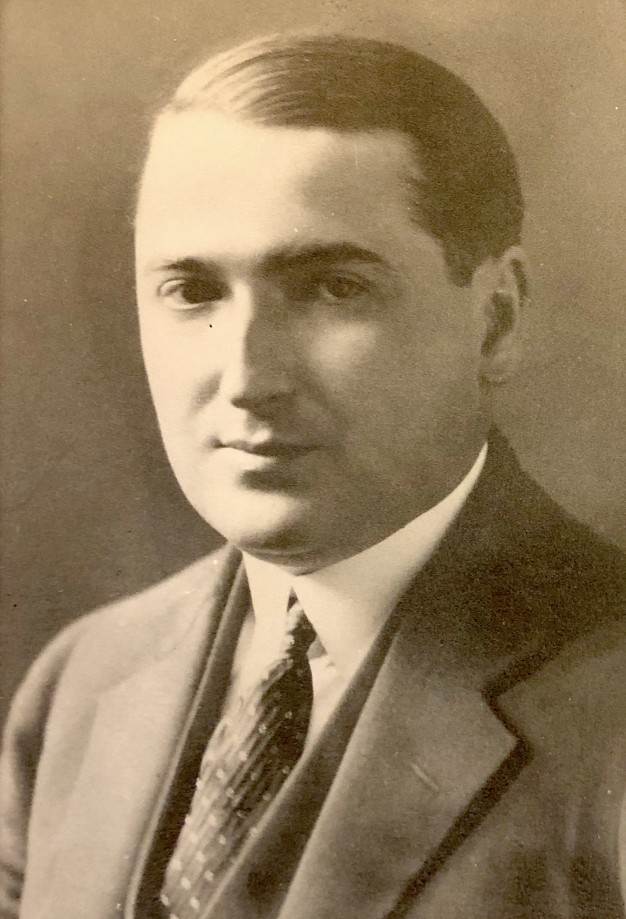

# Problema de correspondencia de Post (PCP)

## Historia

<table>
  <tr>
    <td width="25%">
      
    </td>
    <td>
    El Problema de Correspondencia de Post fue presentado en 1946 por Emil Leon Post, matemático y lógico estadounidense, en el marco de sus investigaciones sobre los límites de la computabilidad.
Su objetivo era estudiar qué problemas podrían resolverse mediante procedimientos mecánicos y cuáles no. A través de un problema aparentemente simple basado en la concatenación de cadenas de símbolos, demostró su indecidibilidad -es decir, la inexistencia de un algoritmo general capaz de determinar con certeza y en un tiempo finito si existe o no solución para cualquier caso-.
Posteriormente, el PCP se convirtió en una herramienta fundamental para demostrar la indecidibilidad de otros problemas en la teoría de la computación.
</td>
</tr>
</table>

Posteriormente, el PCP se convirtió en una herramienta fundamental para demostrar la indecidibilidad de otros problemas en la teoría de la computación.

## ¿Qué es el Problema de Correspondencia de Post?

El Problema de Correspondencia de Post (PCP) es un problema de decisión de la teoría de la computación que consiste en determinar si es posible formar dos cadenas idénticas a partir de dos listas finitas de cadenas de símbolos.

Dadas dos listas A y B, cada elemento de A está asociado con uno de B mediante un mismo índice.

El objetivo es encontrar una secuencia finita y no vacía de índices que, al concatenar las cadenas seleccionadas de ambas listas en el mismo orden, produzca exactamente el mismo resultado.

Para ello, se deben respetar las siguientes condiciones:

- Los índices pueden elegirse en cualquier orden.
- Un mismo índice puede utilizarse más de una vez.
- Cada índice seleccionado debe ser el mismo para ambas listas.

El problema consiste en determinar si existe o no una secuencia que cumpla esta igualdad.

## Ejemplo 1: Representación del PCP mediante fichas de dominó

Una forma visual de comprender el PCP es mediante fichas de dominó, donde cada ficha representa un par de cadenas: una en la parte superior y otra en la inferior.

A continuación, veremos cómo seleccionar y ordenar las fichas para conseguir que ambas concatenaciones sean iguales.

<table>
  <tr>
    <td align="center">
      
      
<b>Ficha 1</b>

    </td>
    <td align="center">
      
      
<b>Ficha 2</b>

    </td>
    <td align="center">
      
      
<b>Ficha 3</b>

    </td>
    <td align="center">
      
      
<b>Ficha 4</b>

    </td>
  </tr>
</table>

El objetivo es encontrar una secuencia finita de fichas que, al concatenar las cadenas superiores e inferiores, produzcan exactamente la misma palabra. Las fichas pueden utilizarse en cualquier orden y repetirse tantas veces como sea necesario.

Para comenzar, elegimos la ficha 2 (a/ab), ya que ambas cadenas empiezan con el mismo símbolo. A partir de ahí, seleccionamos las siguientes fichas buscando compensar los símbolos que van quedando pendientes en alguna de las dos cadenas.

<table>
  <tr>
    <th>Paso</th>
    <th>Secuencia de fichas</th>
  </tr>

  <tr>
    <td>Paso 1</td>
    <td>
      
    </td>
  </tr>

  <tr>
    <td>Paso 2</td>
    <td>
      
      
    </td>
  </tr>

  <tr>
    <td>Paso 3</td>
    <td>
      
      
      
    </td>
  </tr>

  <tr>
    <td>Paso 4</td>
    <td>
      
      
      
      
    </td>
  </tr>

  <tr>
    <td>Paso 5</td>
    <td>
      
      
      
      
      
    </td>
  </tr>
</table>

Siguiendo este procedimiento, obtenemos la secuencia de fichas **2 → 1 → 3 → 2 → 4**.

- Cadena superior: **A B CA A ABC = ABACAAABC**
- Cadena inferior: **AB CA A AB C = ABACAAABC**

Como ambas cadenas son iguales, encontramos una solución para esta instancia del PCP.

## Ejemplo 2: Representación del PCP mediante tabla

El PCP también puede representarse mediante una tabla, donde dadas dos listas A y B de cadenas sobre un alfabeto, hay que determinar si existe una concatenación de cadenas A y B de la forma:

- `xi1 xi2 ... xim = wi1 wi2 ... wim`, donde `xij ∈ A` y `wij ∈ B` (si elijo el índice `i` para `x`, elijo el mismo índice `i` para `w`).

| i | Lista A (`xi`) | Lista B (`wi`) |
| --- | --- | --- |
| 1 | 10 | 1 |
| 2 | 1 | 01 |
| 3 | 00 | 11 |

El objetivo sigue siendo el mismo: encontrar una secuencia de índices que permita formar cadenas idénticas al concatenar los elementos de A y de B.

En este caso, comenzamos con el índice 1, ya las cadenas de las listas A y B comienzan con el mismo símbolo, y continuamos seleccionando índices para compensar los símbolos que van quedando pendientes.

| Lista / Índice | 1 |
| --- | --- |
| A | 10 |
| B | 1 |

| Lista / Índice | 1 | 2 | Concatenación |
| --- | --- | --- | --- |
| A | 10 | 1 | 101 |
| B | 1 | 01 | 101 |

La secuencia de índices que seguimos es **1 → 2**.

Como ambas cadenas son iguales, encontramos una solución para esta instancia del PCP.

Consideremos ahora otro conjunto de cadenas:

| i | Lista A (`xi`) | Lista B (`wi`) |
| --- | --- | --- |
| 1 | 10 | 101 |
| 2 | 011 | 11 |
| 3 | 101 | 011 |

En este caso, el índice con el que comenzamos es el 1, porque los elementos de la lista A y de la lista B deben coincidir desde el primer símbolo.

Al intentar continuar con los índices 1 o 2, aparecen diferencias entre las cadenas que ya no pueden corregirse.

| Lista / Índice | 1 | 1 | Concatenación |
| --- | --- | --- | --- |
| A | 10 | 10 | 101**0** |
| B | 101 | 101 | 101**1**01 |

| Lista / Índice | 1 | 2 | Concatenación |
| --- | --- | --- | --- |
| A | 10 | 011 | 10**0**11 |
| B | 101 | 11 | 10**1**11 |

Si elegimos el índice 3, los símbolos coinciden parcialmente, pero queda un 1 pendiente en la lista B.

| Lista / Índice | 1 | 3 | Concatenación |
| --- | --- | --- | --- |
| A | 10 | 101 | 10101 |
| B | 101 | 011 | 101011 |

Para compensarlo, necesitamos seleccionar una cadena de la lista A que comience con 1.

Si seleccionamos el índice 1:

| Lista / Índice | 1 | 3 | 1 | Concatenación |
| --- | --- | --- | --- | --- |
| A | 10 | 101 | 10 | 101011**0** |
| B | 101 | 011 | 101 | 101011**1**01 |

La única opción válida es volver a elegir el índice 3, pero esto nos lleva nuevamente a la misma situación, repitiéndose el proceso indefinidamente, sin alcanzar la igualdad entre ambas cadenas.

Esta instancia del PCP no tiene solución.

## Indecidibilidad del Problema de Correspondencia de Post

En los ejemplos anteriores vimos que algunas instancias del PCP tienen solución, mientras que otras no.

El PCP es un problema indecidible porque no existe un algoritmo general que, para cualquier par de listas de cadenas, pueda determinar en una cantidad finita de pasos si existe o no una solución.

Si encontramos una secuencia que produce cadenas iguales, podemos comprobar que es una solución. Sin embargo, si no encontramos ninguna, no siempre podemos determinar si no existe o si simplemente todavía no la encontramos.

## ¿Qué similitud exacta tiene con el Problema de la Parada de Turing?
El problema de la parada y el problema de correspondencia de Post son dos problemas fundamentales de indecidibilidad en la teoría de la computación, es decir que no hay un algoritmo general capaz de resolver un determinado problema para todas las combinaciones posibles de programas y entradas pero no es solo que los dos sean indecidibles, hay una relación directa entre ambos mediante una reducción: La forma en que se demuestra que el PCP es indecidible es construyendo una reducción desde el problema de la parada, es decir, si existiría un algoritmo que resolviera el PCP en general, ese mismo algoritmo se podria usarse para resolver el problema de la parada. Esto se logra traduciendo cualquier máquina de Turing M y entrada w en una instancia del PCP, de forma que M se detiene con w si y sólo si esa instancia del PCP tiene solución. Como ya sabemos que el problema de la parada es indecidible, si el PCP fuera decidible, también lo sería la parada, lo cual es una contradicción. Por lo tanto, el PCP también es indecidible. Formalmente esto se expresa como una cadena de reducciones: `HALT ≤ MPCP ≤ PCP`, una notación que representa una cadena de afirmaciones matemáticas formales, cada una demostrada con una construcción concreta, que en conjunto prueban que el PCP es indecidible como el problema de la parada.

## Uso actual / Por qué importa en la teoría

Su importancia principal se basa en utilizar la imposibilidad comprobada para medir los límites de otros sistemas modernos, demostrar que un problema nuevo es indecidible usando el problema de la parada de la máquina de turing puede ser una gran complicación de cintas y transiciones. Por su parte, el PCP lo simplifica mapeando la estructura al juego de las fichas (reducción) y de esa manera se hereda la indecibilidad, es un atajo matemático. El PCP permite definir límites entre compiladores y lenguajes de programación, demuestra que es matemáticamente imposible programar un software que analice un lenguaje y responda con certeza a preguntas sobre reglas ambiguas o lenguajes distintos que generen exactamente los mismos resultados.

Al probar que no puede existir un analizador de código universal e infalible, permitió que la industria utilice análisis heurísticos que asuman un margen de fallo, o que directamente se diseñen lenguajes más restrictivos de base.

En la actualidad el PCP se utiliza para demostrar que ciertos problemas geométricos o de álgebra lineal no tienen solución, como el problema de la mortalidad que busca multiplicar una secuencia aleatoria de matrices y que de cero, o decidir si un conjunto de baldosas puede cubrir un plano infinito sin chocar.

