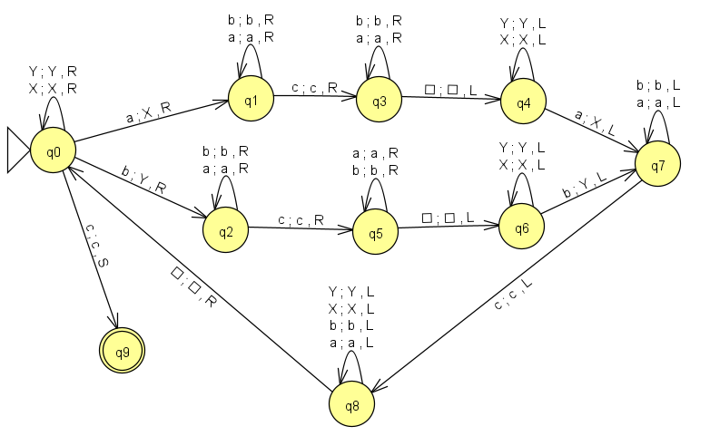
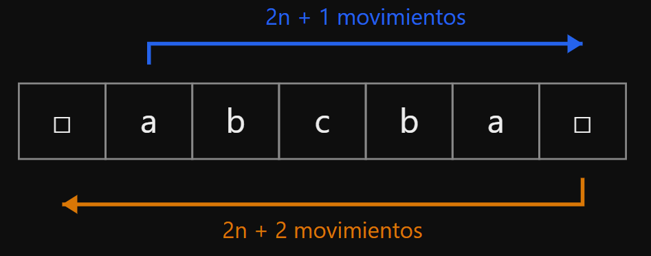
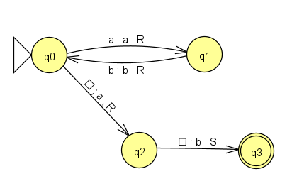

## Actividad 7

## Complejidad Computacional

#### Determinar complejidad espacial y temporal

Ejercicio 1) 

$L = \\{wcw^{-1} / w \in \Sigma^*\\}$

Para la resolución de este ejercicio, vamos a tomar como ejemplo:

- Alfabeto de entrada: $\Sigma = \\{a, b, c\\}$, donde $w \in \\{a, b\\}^*$
- Alfabeto de cinta: $\Gamma = \\{a, b, c, X, Y, \square\\}$

 

*JFLAP*

Haz clic aquí para [Descargar el archivo JFLAP](./archivos/MTEj1.jff)

 

*Turing Machine simulator*

🔗 (http://turingmachinesimulator.com/shared/pppjgtvgmf)

 

*Cálculo de complejidad espacial*

La complejidad espacial $`S(n)`$ mide la cantidad máxima de celdas de la cinta que consulta o utiliza el cabezal de lectura/escritura durante el cálculo en el peor caso, en función del tamaño de la entrada.

En base a la resolución del ejercicio, si llamamos $`n`$ a la longitud de la cadena $`w`$, la entrada completa ocupa $`n + 1 + n = 2n + 1`$ celdas. Se necesitan también dos celdas adicionales en blanco ($`\square`$) para detectar ambos extremos, con lo cual el total de celdas visitadas queda como $`2n + 3`$.

Como se van reemplazando los símbolos por marcas auxiliares sobre la misma cinta, no se necesita almacenar una copia adicional de la palabra.

Por lo tanto, $`S(n) = 2n + 3 \implies S(n) \in O(n)`$, es decir, la complejidad espacial es lineal.

 

*Cálculo de complejidad temporal*

La complejidad temporal $`T(n)`$ mide la cantidad de movimientos que realiza el cabezal en el peor caso, el cual ocurre cuando la palabra pertenece al lenguaje y la máquina debe procesarla por completo (sin considerar el movimiento Stay).

Si llamamos $`n`$ a la longitud de la subcadena $`w`$, la entrada completa tiene longitud $`2n + 1`$. Para cada uno de los $`n`$ símbolos de $`w`$, la máquina realiza un recorrido completo hacia la derecha y otro hacia la izquierda, como puede observarse en la siguiente imagen de ejemplo:

| Operación | Movimientos |
| --- | ---: |
| Recorrer desde el primer símbolo hasta el blanco derecho | $2n+1$ |
| Retroceder hasta el blanco izquierdo | $2n+2$ |
| Volver al primer símbolo de la cinta | $1$ |
| **Total por iteración** | **$4n+4$** |

Como hay \(n\) símbolos en la primera palabra y cada iteración compara un par de símbolos, se realizan \(n\) iteraciones.

Entonces, hasta acá: 

$$
T(n) = n(4n + 4) = 4n^2 + 4n
$$

Una vez marcados todos los símbolos, partiendo del estado q0 se deben recorrer los \(n\) símbolos marcados hasta encontrar c. Esto va a agregar \(n\) movimientos.

$$
T(n) + n
$$
$$
T(n)= 4n^2 + 4n + n
$$
$$
T(n)=4 n^2 + 5n
$$

Por lo tanto, $`T(n) \in O(n^2)`$, es decir, la complejidad temporal es cuadrática.
 
 

Ejercicio 2) f((ab)n) = (ab)n+1

*JFLAP*

Haz clic aquí para [Descargar el archivo JFLAP](./archivos/MTEj2.jff)

 

*Turing Machine simulator*

🔗 (http://turingmachinesimulator.com/shared/rdvadcemyn)

 

*Cálculo de complejidad espacial*

 

*Cálculo de complejidad temporal*